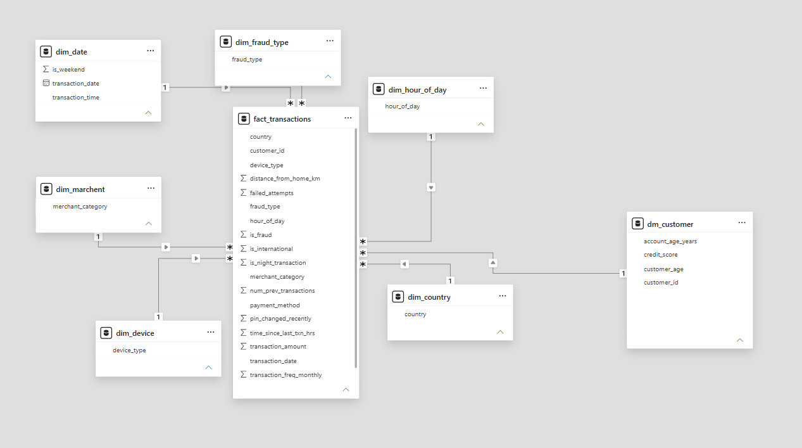

# fraud-detection-dashboard

# Fraud Detection Dashboard (Power BI)

> Interactive Power BI dashboard that helps identify suspicious transactions, fraud trends, and high-risk segments from [credit card / online payment / insurance] data.


Dashboard images



---
Data Modeling(star schema)


## Objective

Give fraud and risk teams a quick view of:
- How much fraud is occurring and how it is changing over time
- Which categories, locations, and customer segments are most at risk
- Which transactions deserve a manual review

## Dataset

- **Source:**  — [https://www.kaggle.com/datasets/ealaxi/paysim1]
- **Records:** [10,000,00] transactions
- **Key columns:** Transaction ID, Date, Amount, Category, Location, Customer ID, Payment Method, Is_Fraud

## Tools Used

| Area | Tool |
|---|---|
| Dashboarding | Power BI Desktop |
| Data cleaning | Power Query |
| Calculations | DAX |
| Data prep (optional) | [Excel / SQL] |

## Data Preparation (Power Query)

- Removed duplicates and null values
- Fixed data types (dates, currency)
- Created [Date table / Amount bands / Time-of-day] columns

## Key DAX Measures

```DAX
Total Transactions = COUNTROWS(Transactions)

Fraud Transactions = CALCULATE([Total Transactions], Transactions[Is_Fraud] = 1)

Fraud Rate % = DIVIDE([Fraud Transactions], [Total Transactions], 0)

Fraud Amount = CALCULATE(SUM(Transactions[Amount]), Transactions[Is_Fraud] = 1)
```

*(Replace with your actual measures.)*

## Dashboard Pages

1. **Overview:** KPI cards (total transactions, fraud count, fraud rate, fraud amount), monthly trend
2. **Fraud Analysis:** fraud by category, location, payment method, time of day
3. **High-Risk Transactions:** table of flagged transactions with filters/slicers

## Key Insights

- Fraud rate peaks at 4.2% during late-night hours (12–4 AM)
- electronic accounts for 31% of total fraud amount
- Transactions above ₹10000 show 4× higher fraud rate
- Top 3 locations contribute 47% of fraud cases

## Features

- Slicers for date, category, location, payment method
- Drill-through to transaction-level details
- [Tooltips / bookmarks / conditional formatting]

## How to Use

1. Download `Fraud_Detection.pbix`
2. Open in Power BI Desktop
3. Refresh data source if prompted (update the file path)
4. Use slicers to explore

## Project Structure

```
fraud-detection-dashboard/
├── data/                    # dataset (CSV/Excel)
├── Fraud_Detection.pbix     # Power BI file
├── images/                  # dashboard screenshots
└── README.md
```

## Future Improvements

- Add risk scoring for each transaction
- Connect to a live database for real-time refresh
- Add anomaly detection visuals

## Author

**Vaishu mundru**
B.Tech  Ece · Aspiring Data Analyst
linkedin : [https://www.linkedin.com/in/vaishnavi-mundru-48b654375?utm_source=share_via&utm_content=profile&utm_medium=member_android] 
·gitHub : [https://github.com/mundruvaishnavi8]
